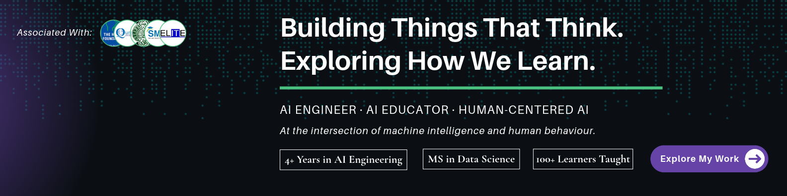

<!--
 BANNER SETUP:
 Upload your banner image to this repository as:
 assets/profile-banner-1.png
-->

  

<h1 align="center">Salam, I'm Javeria Hassan 👋</h1>

<h3 align="center">Applied AI Engineer · AI Educator · Human-Centered AI Enthusiast</h3>

  Building intelligent applications, exploring generative AI, and learning how technology can better support people.

  
  
  
  
  
  
  
  

## About Me

I'm an **Applied AI Engineer** with 4+ years of experience building AI-powered applications, LLM systems, intelligent automation solutions, and full-stack software.

I enjoy working across the AI development lifecycle, from understanding a problem and designing its architecture to building, integrating, and deploying practical solutions.

My engineering work includes:

- Building LLM-powered applications, RAG systems, AI agents, and multi-agent workflows.
- Developing Voice AI applications, conversational agents, and AI calling systems.
- Engineering computer vision, OCR, and recommendation solutions.
- Designing backend services, APIs, and intelligent automation workflows.
- Integrating AI models, external APIs, and automation platforms into practical applications.

I also have a background in technical education, including teaching AI, machine learning, data science, and software development, as well as developing curricula and project-based learning materials.

Beyond engineering, I'm curious about how people learn, think, make decisions, and adapt. I'm particularly interested in the intersection of artificial intelligence, learning science, cognitive science, and human-computer interaction.

I believe technology should do more than become increasingly intelligent. It should become more useful to the people it serves.

## Areas of Interest

- Applied AI, Generative AI, and Multi-Agent Systems
- LLM Applications, RAG, and Intelligent Automation
- Voice AI and Conversational Agents
- AI Calling Agents and Voice Automation
- Agentic Workflows and Tool-Using Agents
- Human-Centered AI and Adaptive Systems
- AI for Learning and Personalized Learning Experiences
- Cognitive Science and Human Behavior
- Human-AI Interaction
- Research, Experimentation, and Product Development

## Tech Stack

### AI, Machine Learning and Data Science

  

  
  
  

### LLMs and Agentic AI

  
  
  
  
  
  

### Voice AI, Agents and Automation

  
  
  
  

Voice AI, Speech-to-Text, Text-to-Speech, Conversational AI, AI Calling Agents, Tool Calling, API Orchestration, Webhooks, Multi-Agent Workflows, and Business Process Automation.

### Full-Stack Development

  

### Databases and Infrastructure

  

### Automation and AI-Assisted Development

  
  
  
  

## Teaching and Knowledge Sharing

I enjoy making technical concepts easier to understand and helping people learn by building things.

My teaching experience includes AI, machine learning, data science, Python, and full-stack web development. I've also contributed to curriculum development, practical learning materials, and project-based instruction.

I see teaching as another way to explore ideas, strengthen my own understanding, and make technology more accessible.

## Writing and Technical Exploration

I enjoy documenting what I build, sharing technical insights, and exploring ideas across AI and software engineering.

I'll be sharing project walkthroughs, engineering experiences, experiments, and lessons learned on Medium.

  
  

## Beyond Engineering

I'm naturally curious and tend to explore ideas across different fields. Some things I enjoy outside my day-to-day engineering work:

- 📚 A keen book reader, always looking for a new idea or perspective.
- 🧠 Exploring cognitive science, psychology, and human behavior.
- ✍️ Writing down ideas, observations, and things I'm learning.
- 🔬 Following interesting research and experimenting with new concepts.
- 🌱 Learning across disciplines and connecting ideas in unexpected ways.

## Currently Exploring

- Building more reliable and useful LLM-powered systems.
- Exploring AI for Learning and personalized learning experiences.
- Learning more about cognitive science and human-AI interaction.
- Experimenting with AI-assisted software engineering workflows.

## Let's Connect

I'm always happy to connect with people who enjoy building, learning, researching, and exploring ideas at the intersection of technology and human experience.

  <a href="https://www.linkedin.com/in/javeria-hassan/">LinkedIn</a> ·
  <a href="https://github.com/Javeria-Hassan-SE">GitHub</a> ·
  <a href="https://www.kaggle.com/javeria00">Kaggle</a> ·
  <a href="https://medium.com/@codewithjaveria">Medium</a> ·
  <a href="https://www.instagram.com/codewithjaveria/">Instagram</a> ·
  <a href="https://www.youtube.com/@codewithjaveria">YouTube</a> ·
  <a href="https://javeria-hassan.vercel.app">Portfolio</a> ·
  <a href="mailto:javeria.hassan77@gmail.com">Email</a>

  <i>Curious mind. Engineering mindset. Always learning.</i>

